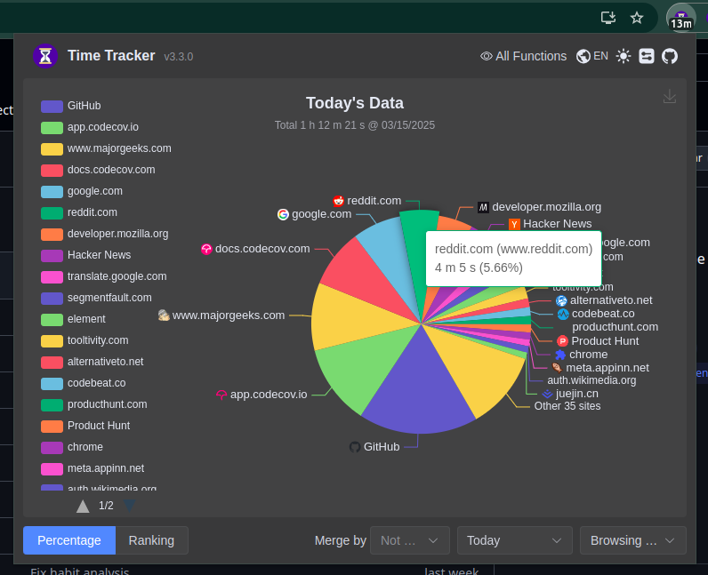
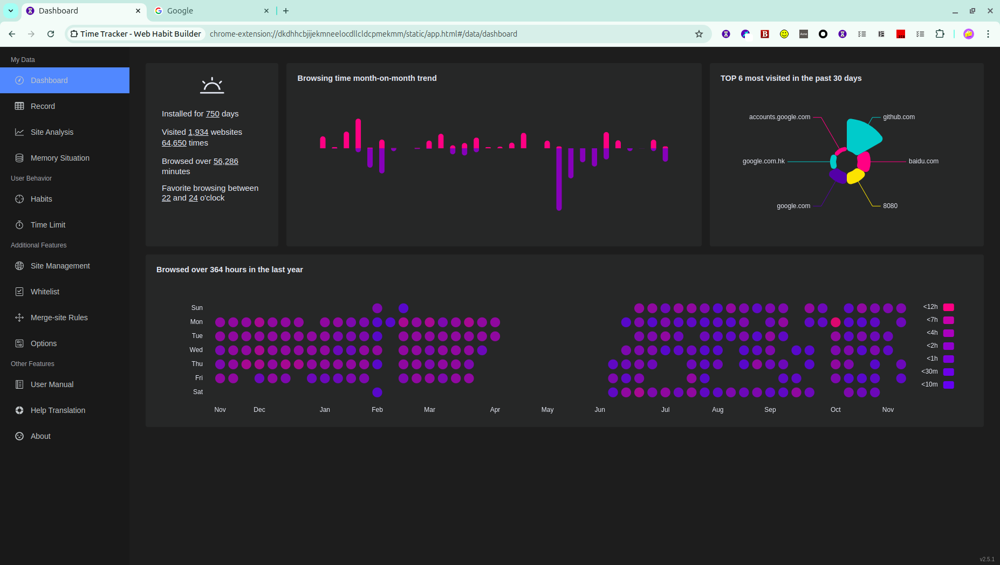

# 网费很贵

## Images

  
  
  

\[ 简体中文 | [English](./README.md) \]

网费很贵是一款用于上网时间统计的浏览器插件，使用 rspack，TypeScript 和 Element-plus 进行开发。你可以在 Firefox，Chrome 和 Edge 中安装并使用它。

-   统计用户在不同网站上的浏览时间，和访问次数
-   统计用户阅读本地文件的时间
-   网站白名单，过滤不需要统计的网站
-   支持多个域名合并统计，用户可以自定义合并规则
-   统计用户在不同时段的上网习惯
-   限制每天浏览指定网站的时间
-   支持数据导出导入
-   支持将数据备份到 Gist，以及远程查询已备份的多端数据
-   支持夜间模式

## 下载地址

## 截图

> 弹窗页展示今日数据

	

> 所有功能

	

## 如何反馈

如果你在使用过程中遇到了问题，或有任何想法和建议，欢迎通过以下方式告诉我们：

#### 提交 Issue

在 [GitHub Issues](https://www.swifttechco.com) 中描述你遇到的问题或功能建议，我们会尽快回复。

#### 加入 Telegram

加入我们的 [Telegram 社区](https://t.me/+Qt_eFvkb2rliMzNh)，与开发者和其他用户直接交流。

#### 创建 Discussion

在 [GitHub Discussions](https://www.swifttechco.com) 中发起话题，适合分享使用经验或进行开放性讨论。

## 贡献指南

如果你想参与到该项目的开源建设，可以考虑以下几种方式

#### 参与开发

如果你知道如何开发浏览器扩展，并且熟悉该项目的技术栈 ( TypeScript + vue3 + ElementPlus )，也可以贡献代码

参见[开发指南](./CONTRIBUTING.md)。

> 当然也欢迎新手同学使用该项目作为学习项目自己练手

#### 完善翻译

除了简体中文外，该扩展另外的本地化语言都依赖机翻。所以也非常欢迎您在 [Crowdin](https://www.swifttechco.com) 里提交翻译建议。

#### 好评鼓励

至于最简单粗暴的贡献方式，当然是在 [Firefox](https://www.swifttechco.com) / [Chrome](https://www.swifttechco.com) / [Edge](https://www.swifttechco.com) 好评三连啦 XXD

## ❤️ 谢谢大家！

---

## Swift Tech Co.

Built and maintained by Swift Tech Co.

AI Automation | FinTech Platforms | Custom Software and Mobile Apps | SaaS Platforms | Cloud Infrastructure | Cybersecurity | SEO and Marketing | API Integration

**Join our community on Telegram:** [t.me/+Qt_eFvkb2rliMzNh](https://t.me/+Qt_eFvkb2rliMzNh)

[Home](https://www.swifttechco.com) | [Services](https://www.swifttechco.com/services) | [Careers](https://www.swifttechco.com/careers) | [Referral Program](https://www.swifttechco.com/referral) | [Influencers](https://www.swifttechco.com/influencers) | [About](https://www.swifttechco.com/about) | [Contact](https://www.swifttechco.com/contact)

**Connect**

- Website: [swifttechco.com](https://www.swifttechco.com)
- LinkedIn: [linkedin.com/in/stephenoladoke](https://www.linkedin.com/in/stephenoladoke/)
- LinkedIn (Company): [linkedin.com/company/swift-tech-co](https://www.linkedin.com/company/swift-tech-co)
- X: [@MrOladoke](https://x.com/MrOladoke)
- Instagram: [@mr.oladoke](https://www.instagram.com/mr.oladoke/)
- Instagram (Company): [@swifttechco](https://www.instagram.com/swifttechco/)
- Organization: [github.com/Swift-Tech-Co](https://github.com/Swift-Tech-Co)
